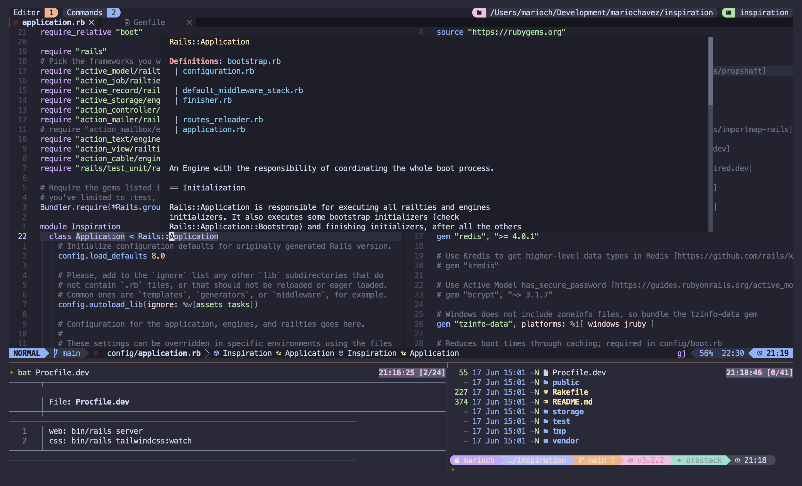

# Configuration files

These dotfiles are my base configuration for the following tools.

- [Zsh](https://www.zsh.org)
- [Ghostty](https://ghostty.org/)
- [Starship](https://starship.rs)
- [fzf](https://github.com/junegunn/fzf)
- [fd](https://github.com/sharkdp/fd)
- [bat](https://github.com/sharkdp/bat)
- [eza](https://github.com/eza-community/eza)
- [zoxide](https://github.com/ajeetdsouza/zoxide)
- [yazi](https://github.com/sxyazi/yazi)
- [Neovim](https://neovim.io)
- [LazyVim](https://www.lazyvim.org)
- [Git](https://git-scm.com)
- [Lazygit](https://github.com/jesseduffield/lazygit)
- [Tmux](https://github.com/tmux/tmux)
- [herdr](https://herdr.dev/)
- [mise](https://mise.jdx.dev/)
- [zsh-autosuggestions](https://github.com/zsh-users/zsh-autosuggestions)
- [zsh-syntax-highlighting](https://github.com/zsh-users/zsh-syntax-highlighting)
- [stow](https://www.gnu.org/software/stow/)

Tools that support color scheme is using a [catppuccin](https://github.com/catppuccin/catppuccin) theme.

Neovim and Lazyvim configurations are specially configured for Ruby on Rails development, but it is easy to enable
other languages features specific with extra packages from LazyVim.

Shell, Terminal, are tools were setup for my best experience working with code, but they also looks good.



## Supported platforms

These configs run on **macOS** and on **[Omarchy](https://omarchy.org/)** (Arch Linux +
Hyprland) from the same files. Nothing is forked per OS: the shell branches on three
flags set at the top of `.zshrc` (`IS_MACOS`, `IS_LINUX`, `IS_OMARCHY`), and the ghostty
config uses an optional include so one file covers both machines.

## Installation

Clone the repository into your home directory and run the installer. It detects the
platform, installs the packages, and stows every package in this repo.

```bash
git clone https://github.com/mariochavez/dotfiles .dotfiles
cd .dotfiles
./install.sh
```

Useful flags: `--dry-run` (show what would happen), `--stow-only`, `--packages`.

Any real file already sitting where a symlink needs to go is moved to
`~/.dotfiles-backup/<timestamp>/` first — on Omarchy that is how the distro's own
`ghostty` and `mise` configs get out of the way. The installer never uses
`stow --adopt`, which would pull the machine's current config into the repo.

Close your terminal, open Ghostty, and you should be ready.

### Doing it by hand

```bash
# macOS
brew install git lazygit ghostty starship fzf fd eza bat zoxide neovim tmux yazi \
  zsh-autosuggestions zsh-syntax-highlighting stow font-meslo-lg-nerd-font

# Omarchy / Arch — most of this ships with Omarchy; only the two zsh plugins
# and the Nerd Font are actually missing from a stock install
omarchy pkg add git lazygit ghostty starship fzf fd eza bat zoxide neovim tmux yazi \
  stow zsh zsh-autosuggestions zsh-syntax-highlighting ttf-meslo-nerd wl-clipboard
```

herdr has its own installer on both platforms.

```bash
curl -fsSL https://herdr.dev/install.sh | sh
```

Then stow the packages:

```bash
stow bat bin ghostty herdr mise nvim pi starship tmux yazi zsh

# Linux only — pbcopy/pbpaste shims. macOS provides those natively, so stowing
# this package there would shadow the real binaries.
stow bin-linux
```

On Omarchy, make zsh your login shell if it isn't already — Omarchy defaults to bash:

```bash
chsh -s "$(command -v zsh)"
```

### Per-machine steps stow can't do

`stow` only links configuration. These are installed from outside this repo and have to
be set up once per machine: the [pi plugins](#pi-plugins), [Ollama](#ollama) (pi's
default provider, and a daemon that must be running), the
[herdr plugins](#herdr-plugins), and the tmux plugins (`prefix + I` on first run).

## pi plugins

[pi](https://github.com/earendil-works/pi-coding-agent) needs these eleven packages.
They are installed from npm and Git rather than tracked here, so a fresh machine needs
them installed once:

```bash
pi install npm:pi-web-access
pi install npm:pi-mcp-adapter
pi install npm:pi-subagents
pi install npm:pi-intercom
pi install npm:@spences10/pi-lsp
pi install npm:pi-ollama-cloud
pi install npm:pi-prompt-template-model
pi install npm:@juanibiapina/pi-extension-settings
pi install npm:@juanibiapina/pi-powerbar
pi install git:github.com/kreeger/pi-statusbar
pi install https://github.com/davebcn87/pi-autoresearch
```

This is the complete set — anything else installed under `~/.pi/agent/` should be
removed. The same eleven are listed in the `packages` array of
`pi/.pi/agent/settings.json`, which is what pi actually reads; keep the two in sync.

[`pi/README.md`](pi/README.md) has the rest: what each package provides, which files are
tracked, and the local-only secrets (`auth.json`, `web-search.json`) to restore by hand.

## Ollama

pi's `settings.json` sets `defaultProvider` to `ollama`, and the `ollama` provider in
`pi/.pi/agent/models.json` points at `http://127.0.0.1:11434/v1`. That is a **local**
daemon, so it has to be installed and running on every machine or pi fails with a bare
`Error: Connection error.` retried three times.

This applies to the `:cloud` models too. Ollama serves those by proxying through the same
local daemon, so "cloud" does not mean "no local install".

### Install and start it

```bash
# Omarchy / Arch — add ollama-rocm (AMD) or ollama-cuda (NVIDIA) for GPU acceleration
omarchy pkg add ollama ollama-rocm
sudo systemctl enable --now ollama

# macOS
brew install ollama
brew services start ollama
```

`enable --now` both starts the service and brings it back after a reboot; `systemctl
start ollama` alone will not survive one.

### Authenticate for cloud models

Models with a `:cloud` suffix need an ollama.com account. The daemon signs requests with
the keypair at `~/.ollama/id_ed25519`, which is generated on first run but not registered
until you sign in:

```bash
ollama signin
```

### Verify

```bash
curl -s http://127.0.0.1:11434/v1/models
```

A JSON list means pi will connect. Connection refused means the service is not running —
check `systemctl status ollama`.

### A note on the model defaults

Both providers in `models.json` assume a server this repo does not install: `ollama` on
localhost, and `mac-arch` at a hardcoded LAN address (`http://192.168.68.109:8080/v1`).
The LAN address in particular is per-machine and per-network, so treat `defaultProvider`
and `defaultModel` as settings to override locally rather than values that are correct
everywhere.

## Living with Omarchy

A few things worth knowing when these dotfiles are stowed on an Omarchy box.

**Themes still work.** `omarchy theme set <name>` writes to
`~/.local/state/omarchy/current/theme/`, and the ghostty config pulls that in through an
optional include placed after the Catppuccin baseline, so the live theme wins on Omarchy
and macOS falls back to Catppuccin Mocha. The include is silently skipped on macOS, where
the path does not exist.

**`omarchy update` can edit tracked files.** Omarchy migrations `sed -i` and append to
files under `~/.config` — `tmux.conf` has been touched this way. Because those paths are
stow symlinks into this repo, the edits land *in the repo*. That
is mostly a feature, since the changes get versioned, but run `git status` here after an
`omarchy update` and review what changed.

**Clipboard.** `bin-linux/` supplies `pbcopy` and `pbpaste`, the two names macOS has
natively and Linux does not. They are scripts rather than aliases because the `cpy*`
helpers in `bin/` are scripts, and scripts do not inherit shell aliases — that is what
lets those helpers work unchanged on both machines.

`pbcopy` checks for an SSH session *first*, before looking at `WAYLAND_DISPLAY` or
`DISPLAY`. When you are working over ssh/tmux/herdr the clipboard you want is the one on
the machine you are typing at, and an OSC 52 escape travels back to that terminal;
checking the display first would silently copy to the remote host instead. Locally it
uses `wl-copy`/`wl-paste`.

`pbpaste` has no OSC 52 path — terminals generally refuse clipboard *reads* — so over SSH
it reads the remote machine's clipboard. Copy is the direction that needs to travel.

## herdr plugins

`stow` only links the herdr configuration. The plugins it refers to live in
`~/.config/herdr/plugins.json`, which is outside this repository, so they have to be
installed once per machine. Until you do, the keybindings that invoke their actions
resolve to nothing.

```bash
herdr plugin install lmilojevicc/herdr-splits.nvim
herdr plugin install smarzban/herdr-file-viewer
```

Then reload the configuration:

```bash
herdr server reload-config
```

### herdr-splits

Gives one set of `ctrl+hjkl` that walks across Neovim splits and herdr panes as if they
were the same layout, with `alt+hjkl` to resize. It is the herdr equivalent of
`vim-tmux-navigator`, which does not work here: that plugin crosses edges by calling
`tmux select-pane`, and there is no tmux server inside a herdr pane.

The plugin has two halves that must both be present and agree with each other — the herdr
side installed above, and the Neovim side in `nvim/.config/nvim/lua/plugins/navigator.lua`,
which `lazy.nvim` installs on first start. The Neovim half writes
`~/.config/herdr/plugins/config/herdr-splits/herdr-splits.conf` on every `setup()` so that
the herdr-side scripts read the same keys; that file is generated and should not be edited
by hand.

Two things worth knowing:

- `ctrl+l` no longer reaches the shell as clear-screen, since herdr claims it in non-Neovim
  panes. `prefix+ctrl+l` re-sends the real keystroke.
- `alt+hjkl` needs Ghostty configured to send Option as Meta, otherwise the resize keys type
  `˙∆˚¬`. Navigation is unaffected.

### herdr-file-viewer

A git-aware read-only file browser, opened with `prefix+f` in a split or `prefix+shift+f` in
its own tab.
